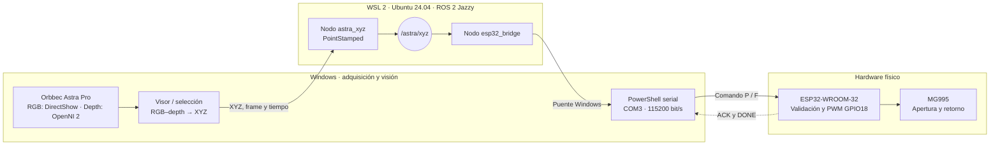
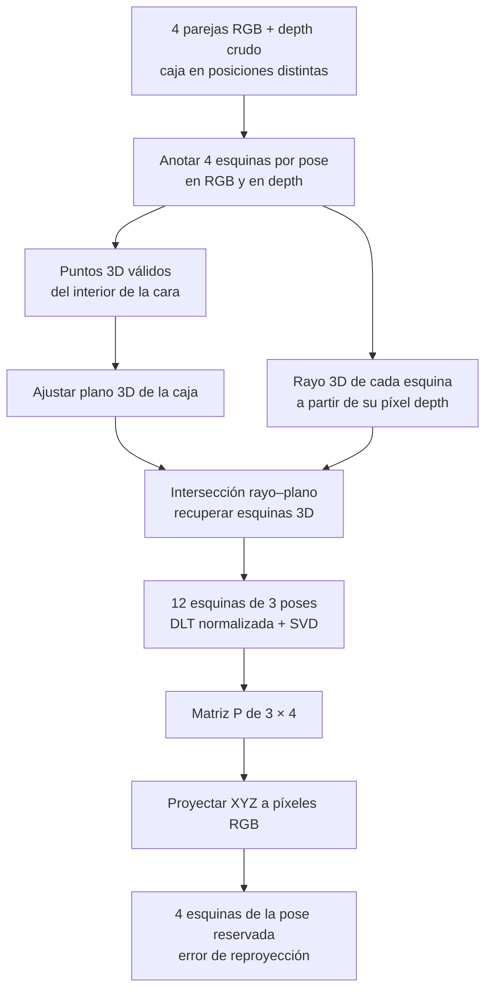
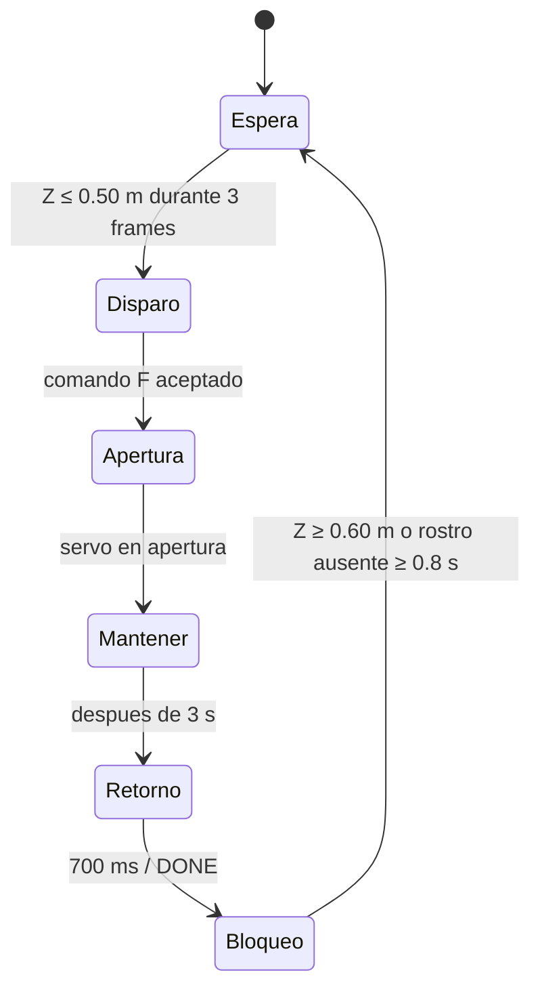

<div align="center">

# Astra Pro × ROS 2 × ESP32

### De la percepción RGB-D a la actuación mecatrónica

**Visión 3D · Calibración RGB–profundidad · Comunicación ROS 2 · Control embebido**


**Estado: prototipo experimental con integración física demostrada**

</div>

---

Una **Orbbec Astra Pro** observa una escena, permite asociar un píxel RGB con un punto tridimensional y publica ese punto en **ROS 2 Jazzy**. Un puente de comunicación lleva las coordenadas al **ESP32**, que acciona un **servomotor MG995** y confirma la secuencia. El sistema también demuestra la apertura automática de una **puerta simulada** cuando un rostro frontal se aproxima a una distancia definida.

El proyecto reúne cuatro retos de ingeniería en una misma cadena: **adquisición RGB-D**, **alineación geométrica**, **comunicación entre sistemas** y **accionamiento físico con confirmación**.

| Profundidad adquirida | Error RMS de proyección | Prueba manual | Activación automática |
|:---:|:---:|:---:|:---:|
| **640 × 480 · 30 fps** | **4,72 px** | **16 ciclos `DONE`** | **Z ≤ 0,50 m** |
| Astra Pro | Pose reservada | ESP32 + MG995 | 3 fotogramas consecutivos |

> [!IMPORTANT]
> Las cifras corresponden a las **pruebas documentadas**, no a prestaciones garantizadas del sensor ni a un sistema de control de acceso certificado. El detector frontal **no identifica a las personas**.

## Contenido

- [Arquitectura y diagrama de bloques](#arquitectura-y-diagrama-de-bloques)
- [Tecnologías y hardware](#tecnologías-y-hardware)
- [Puesta en marcha](#puesta-en-marcha)
- [Calibración RGB–depth: metodología y resultados](#calibración-rgbdepth-metodología-y-resultados)
- [Modos de operación](#modos-de-operación)
- [ROS 2 y protocolo serial](#ros-2-y-protocolo-serial)
- [Validación experimental](#validación-experimental)
- [Estructura del proyecto](#estructura-del-proyecto)
- [Limitaciones y continuidad](#limitaciones-y-continuidad)

---

## Arquitectura y diagrama de bloques

El visor procesa la captura en **Windows**, mientras que los nodos se ejecutan en **Ubuntu 24.04 sobre WSL 2**. La comunicación con el ESP32 se realiza mediante un proceso de Windows que abre el puerto serie.



**Recorrido del dato:** Astra Pro → visor Windows → `astra_xyz` → `/astra/xyz` → `esp32_bridge` → PowerShell/COM3 → ESP32 → MG995.

El sistema utiliza **tópicos ROS 2** para distribuir puntos; la implementación documentada **no requiere servicios ROS 2**. La publicación continua del píxel central y el visor interactivo son modos alternativos que utilizan la misma cámara, por lo que deben ejecutarse por separado.

### Contrato de coordenadas

| Propiedad | Contrato implementado |
|---|---|
| Tópico | `/astra/xyz` |
| Publicador | `astra_xyz` |
| Tipo | `geometry_msgs/msg/PointStamped` |
| `header.frame_id` | `astra_depth_optical_frame` |
| Unidades de `point.x`, `point.y`, `point.z` | **metros** |
| Convención óptica | **X → derecha · Y → abajo · Z → delante** |
| Tiempo | Sello de recepción del fotograma en Windows; rechazo de muestras antiguas en WSL |

El punto XYZ corresponde a la referencia óptica de **profundidad**. **No es una coordenada de mundo ni una pose del servomotor**. Para integrar un brazo robótico sería necesaria una transformación adicional entre marcos de referencia.

## Tecnologías y hardware

| Capa | Tecnología | Papel |
|---|---|---|
| Sensor | **Orbbec Astra Pro** | Captura RGB y profundidad |
| Captura RGB | **DirectShow** | Obtención de imagen en Windows |
| Captura depth | **OpenNI 2 / API C del SDK Orbbec por `ctypes`** | Lectura de profundidad y conversión 3D |
| Procesamiento | **Python 3.11, OpenCV, NumPy** | Diagnóstico, visor, correspondencias y detección frontal |
| Middleware | **ROS 2 Jazzy (`rclpy`, `geometry_msgs`)** | Publicación/suscripción de XYZ |
| SO de ROS | **Ubuntu 24.04 en WSL 2** | Ejecución de nodos |
| Comunicación | **PowerShell + puerto serial a 115200 bit/s** | Enlace Windows–ESP32 |
| Controlador | **ESP32-WROOM-32**, Arduino ESP32 **3.3.12** | Recepción, protocolo y PWM |
| Actuador | **MG995**, fuente externa de **6,4 V** en el montaje | Giro y retorno de una puerta simulada |

**Identificación observada en el equipo de desarrollo:** `ORBBEC Depth Sensor` (`2BC5:0403`), `Astra Pro HD Camera` (`2BC5:0501`) y adaptador **CP210x** para el ESP32. El índice RGB `1` y el puerto `COM3` son valores de **ese equipo**, no parámetros universales.

## Puesta en marcha

> [!NOTE]
> Las instrucciones usan **PowerShell en Windows** para la cámara y **Bash en WSL 2** para ROS. Antes de operar el servo, revisa la alimentación y el cableado descritos más abajo. La prueba física puede producir movimiento inmediatamente después de recibir una orden válida.

### 1. Preparar el entorno de visión en Windows

Instala **Python 3.11 de 64 bits**, el **SDK Orbbec OpenNI 2.3.0.86** y conecta la Astra Pro. Cierra **NiViewer** u otras aplicaciones que hayan abierto el sensor.

Abre PowerShell en la raíz del proyecto y define las rutas para **tu propia instalación**:

```powershell
# Comprueba que este Python es 3.11 x64.
$python = (Get-Command python).Source
& $python --version

# Introduce la ruta real de la carpeta NiViewer del SDK de Orbbec.
$sdk = Read-Host 'Ruta completa de NiViewer (SDK Orbbec)'

# Prepara el entorno de visión.
& $python -m venv .venv
& .\.venv\Scripts\python.exe -m pip install -r .\diagnostico\requirements-rgb.txt
$vision = '.\.venv\Scripts\python.exe'
```

El parámetro `--sdk` recibe la **ruta local a la carpeta NiViewer** que contiene las bibliotecas necesarias; no es un enlace web. Para una nueva instalación, comprueba primero su ubicación en tu equipo.

### 2. Verificar profundidad

```powershell
& $python -B .\diagnostico\probar_profundidad.py --sdk $sdk --muestras 30
```

El diagnóstico presenta la URI, el modo de captura, la muestra central y la mediana de valores válidos. Sus códigos de salida son **0** (alguna lectura válida), **1** (fallo de captura/entorno) y **2** (sin profundidad válida central o argumentos inválidos).

### 3. Iniciar ROS 2 en WSL 2

En **otra terminal** de Ubuntu 24.04:

```bash
source /opt/ros/jazzy/setup.bash
ros2 --help
```

Para verificar la publicación continua del **centro del depth crudo**, desde PowerShell:

```powershell
& $python -B .\diagnostico\emitir_xyz.py --sdk $sdk --ros
```

Desde la terminal Ubuntu:

```bash
ros2 node info /astra_xyz
ros2 topic echo /astra/xyz
ros2 topic hz /astra/xyz
```

Este modo de diagnóstico produce **hasta cinco puntos por segundo**. El proceso Windows inicia `astra_xyz` en WSL mediante entrada estándar; el nodo omite profundidades nulas y descarta muestras cuya antigüedad supera **un segundo**.

### 4. Preparar el firmware y el puente al ESP32

Conecta el **ESP32** y alimenta el servo mediante su fuente externa. Compila y carga `firmware/astra_receptor/astra_receptor.ino` usando **ESP32 Dev Module** (`esp32:esp32:esp32`) y el núcleo Arduino ESP32 **3.3.12**. Cierra el monitor serial antes de utilizar el puente.

Para iniciar el puente en **Bash de Ubuntu**, desde la raíz del proyecto:

```bash
source /opt/ros/jazzy/setup.bash
python3 -B ros2/esp32_bridge.py --puerto COM3
```

También puedes limitar una prueba con `--ciclos 1`. El ESP32 debe confirmar el protocolo correspondiente a la versión de firmware. **No ejecutes el publicador continuo simultáneamente con el visor interactivo**.

### 5. Elegir un modo interactivo

Con la cámara libre y el firmware compatible:

```powershell
# Selección de un punto RGB con el mouse; publica XYZ y espera DONE.
& $vision -B .\diagnostico\visor_registro.py --sdk $sdk --enviar-ros --puerto COM3
```

O para la demostración automática:

```powershell
# Detector frontal + apertura por proximidad; requiere READY ASTRA2.
& $vision -B .\diagnostico\visor_registro.py --sdk $sdk --rostros --puerto COM3
```

**Para usar los modos interactivos con proyección experimental necesitas** `resultados/calibracion_caja_evaluada.json`, generado para esa cámara, o señalar su ubicación mediante `--calibracion`. Este archivo es local y no se incluye automáticamente al clonar el repositorio.

**El puerto y la cámara solo deben estar abiertos por el proceso adecuado.** Detén con `Ctrl+C` los nodos/puentes de consola y con `Esc` el visor al terminar.

<details>
<summary><strong>Diagnóstico adicional: capturar RGB y profundidad para comparar el registro</strong></summary>

```powershell
& $vision -B .\diagnostico\probar_rgb_depth.py --sdk $sdk --salida .\resultados\caja_080
& $vision -B .\diagnostico\medir_registro.py .\resultados\caja_080
```

La captura guarda RGB original, profundidad de **16 bits en milímetros**, imágenes de contraste y superposiciones. Los bordes de profundidad se resaltan al detectar saltos de al menos **60 mm** entre píxeles válidos. Se capturan imágenes consecutivas: utiliza una **escena inmóvil**.

Para comparar con `--depth-crudo` o `--invertir-rgb`, realiza nuevas capturas en directorios distintos. La orientación original del RGB fue la adecuada en el equipo ensayado; no debe invertirse automáticamente en otros equipos sin comprobarlo.

</details>

---

## Calibración RGB–depth: metodología y resultados

### ¿Por qué fue necesaria?

La Astra Pro entrega imagen RGB y profundidad a través de interfaces de captura independientes. Aunque el SDK permitió activar el registro nativo **depth → RGB**, sus parámetros de fábrica consultados mediante la extensión de Orbbec devolvieron **`NaN`** en esta unidad. Una caja rectangular reveló diferencias espaciales entre los contornos visibles en RGB y depth.

En **cuatro capturas estáticas con registro nativo**, la profundidad apareció desplazada hacia la derecha del RGB en los bordes laterales. La diferencia no fue constante entre posiciones:

| Pose de la caja | Profundidad mediana de la cara | Δu borde izquierdo | Δu borde derecho | Δv borde superior |
|---|---:|---:|---:|---:|
| Centro | 705 mm | +16 px | +14 px | 0 px |
| Izquierda (1) | 1.047 mm | +5 px | +3 px | +1 px |
| Izquierda (2) | 1.057 mm | +8 px | +8 px | 0 px |
| Derecha | 1.094 mm | +11 px | +7 px | +2 px |

Aquí **Δ = posición depth − posición RGB**. Este diagnóstico del **registro nativo** es diferente del conjunto usado posteriormente para ajustar y evaluar la proyección experimental.

### Método: recuperar esquinas 3D y proyectarlas al RGB

Para la calibración se utilizaron **cuatro parejas adicionales de RGB y depth crudo**. La cara frontal de una caja sirve como referencia geométrica local: el interior proporciona puntos depth con los que se estima un plano, mientras que sus esquinas se anotan en ambas imágenes.



**Procedimiento experimental:**

1. Capturar **cuatro pares adicionales** RGB/depth crudo con la caja en distintas poses, manteniendo la imagen RGB en su **orientación original**.
2. Anotar las cuatro esquinas de la misma cara en ambos sensores: superior izquierda, superior derecha, inferior derecha e inferior izquierda.
3. Ajustar un **plano tridimensional** a los puntos válidos del interior de la cara de la caja.
4. Intersectar el **rayo 3D de cada esquina depth** con ese plano, para recuperar una esquina 3D incluso cuando el contorno contiene huecos de profundidad.
5. Estimar una matriz proyectiva **`P` de 3 × 4** con **12 esquinas de tres poses** mediante **transformación lineal directa normalizada (DLT)** y **descomposición en valores singulares (SVD)**.
6. Reservar las **cuatro esquinas de la cuarta pose** para medir el error sin reutilizarlas en el ajuste.

### Modelo matemático

Para un punto de profundidad en metros, la transformación proyectiva es:

$$
\begin{bmatrix}a\\b\\c\end{bmatrix}=
\mathbf{P}\begin{bmatrix}X\\Y\\Z\\1\end{bmatrix},
\qquad
(u_{RGB},v_{RGB})=\left(\frac{a}{c},\frac{b}{c}\right)
$$

Donde `P` tiene dimensiones **3 × 4** y convierte las coordenadas de un punto 3D a una posición proyectada en la imagen RGB. La posición proyectada se compara con la esquina anotada manualmente.

El error individual y el error cuadrático medio de reproyección se definen como:

$$
e_i=\sqrt{(u_{i,\mathrm{pred}}-u_{i,\mathrm{real}})^2+(v_{i,\mathrm{pred}}-v_{i,\mathrm{real}})^2},
\qquad
\mathrm{RMS}=\sqrt{\frac{1}{n}\sum_{i=1}^n e_i^2}
$$

### Resultado en la pose reservada

| Método sobre las mismas cuatro esquinas de evaluación | RMS | Error máximo |
|---|---:|---:|
| Superposición directa del **depth crudo** | **9,58 px** | **13,42 px** |
| Proyección experimental **DLT** | **4,72 px** | **6,12 px** |

> [!TIP]
> La diferencia observada se refiere a la **alineación de cuatro esquinas en una pose de evaluación independiente**, no a la exactitud métrica del sensor ni a una comparación concluyente con el registro nativo del fabricante. Para evaluar DLT **frente al registro nativo**, se necesitan las mismas poses y referencias medidas bajo ambos métodos.

**Limitaciones del ajuste:** anotación manual, una sola pose reservada, matriz sin un término explícito de distorsión, sensibilidad a la región de la imagen y a la distancia de captura. La exactitud absoluta de Z no se ha verificado mediante una referencia externa independiente.

### Cómo reproducir el ajuste

El script utilizado es `diagnostico/calibrar_con_caja.py`, que consume anotaciones previamente preparadas:

```powershell
& $vision -B .\diagnostico\calibrar_con_caja.py `
    .\resultados\anotaciones_calibracion_caja.json `
    .\resultados\nuevo_informe_caja.json
```

**La carpeta `resultados/` está excluida por `.gitignore`.** Incluye las capturas y la matriz específica de la cámara usada; por ello, no se puede asumir que otra persona que clone el repositorio recibirá automáticamente esos archivos. El visor experimental necesita **`resultados/calibracion_caja_evaluada.json`** o una ruta alternativa indicada con `--calibracion`.

Para consultar visualmente los modos, con la cámara libre:

```powershell
& $vision -B .\diagnostico\visor_registro.py --sdk $sdk
# Alternativas de comparación, ejecutadas por separado:
& $vision -B .\diagnostico\visor_registro.py --sdk $sdk --modo nativo
& $vision -B .\diagnostico\visor_registro.py --sdk $sdk --modo crudo
```

En el modo experimental, los puntos de profundidad se proyectan sobre la imagen RGB; si varias muestras llegan al mismo píxel, se conserva **la más cercana**. Los huecos de profundidad se dejan sin información depth.

<details>
<summary><strong>Controles del visor y medición manual de desplazamientos</strong></summary>

| Control | Acción |
|---|---|
| **Clic 1** | Marca el detalle RGB y congela la imagen |
| **Clic 2** | Marca el mismo detalle en profundidad |
| **O** | Alterna RGB solo / superposición |
| **Espacio** | Pausa o reanuda |
| **U** | Deshace la última marca |
| **S** | Guarda medidas locales en `resultados/visor/` |
| **Esc** | Cierra el visor y libera la cámara |

Se muestran `ΔX = u_depth − u_rgb`, `ΔY = v_depth − v_rgb` y `√(ΔX² + ΔY²)`. La **mediana de errores por clic** describe una sesión de medición; **no debe confundirse** con el RMS de validación de la matriz calculado usando las esquinas reservadas.

</details>

---

## Modos de operación

### A. Medición visual de RGB y depth

Permite congelar la imagen, marcar el mismo detalle físico en RGB y depth y visualizar sus diferencias en píxeles. Sirve para diagnosticar el registro y comprobar cómo cambia la superposición entre métodos.

### B. Selección manual de puntos 3D

Al hacer clic sobre una superficie con profundidad válida, el visor obtiene el **XYZ del píxel depth original asociado a ese píxel RGB**, lo publica en `/astra/xyz` y espera la confirmación del ciclo físico. Se ignoran clics en huecos y se impide enviar otra orden mientras no termine la anterior.

```text
Clic válido → XYZ en metros → /astra/xyz → comando P
           → ACK secuencia → movimiento y retorno → DONE secuencia
```

En una sesión real se registraron **16 confirmaciones `DONE`**; las dos primeras fueron:

| Confirmación | X (m) | Y (m) | Z (m) |
|---|---:|---:|---:|
| `DONE 1` | +0,231 | +0,075 | 0,851 |
| `DONE 2` | +0,138 | −0,083 | 0,728 |

### C. Detección frontal y puerta simulada

El detector utiliza una **cascada frontal de OpenCV**. Si aparecen varios rostros, toma el recuadro más grande, extrae el XYZ del centro y, si hay un hueco, busca un punto válido cercano en una ventana de **7 × 7**.



**El flujo no realiza reconocimiento de identidad.** La señal de disparo depende de distancia y persistencia de la detección, no de autorización biométrica. Una profundidad inválida con rostro visible no debe rearmar el sistema.

La demostración automática exige firmware compatible con **`READY ASTRA2`**. El usuario puede seguir utilizando el modo manual mediante `--enviar-ros`.

## ROS 2 y protocolo serial

Consulta la [guía técnica de ROS 2](docs/ROS2.md) para el contrato del mensaje, los procesos de cada modo, el protocolo serial y los comandos de inspección. Los comandos abreviados están en [COMANDOS.txt](COMANDOS.txt) y el recorrido del proyecto en [HISTORIAL_PROYECTO.md](HISTORIAL_PROYECTO.md).

El puente `esp32_bridge` se suscribe a `/astra/xyz`, conserva una sola muestra pendiente y utiliza un proceso de Windows para transmitir al ESP32 por **COM3 a 115200 bit/s**. Se distinguen dos tipos de orden documentados:

| Orden | Uso | Confirmación esperada |
|---|---|---|
| `P secuencia X Y Z` | Ensayo de un punto seleccionado | `ACK secuencia` y después `DONE secuencia` |
| `F secuencia X Y Z` | Disparo de la puerta por rostro cercano | `ACK secuencia` y después `DONE secuencia` |

- **`ACK`** significa que se aceptó la orden, no que el servo terminó.
- **`DONE`** indica que concluyó la secuencia temporizada del firmware. **No es una medida de posición angular**: el MG995 no transmite realimentación de ángulo al ESP32 en este montaje.
- El puente descarta muestras antiguas y **no superpone órdenes concurrentes**.

### Conexión eléctrica esencial

```text
ESP32 GPIO18  ───────────► MG995 (señal PWM)
Fuente externa +6,4 V ───► MG995 (alimentación)
Fuente externa GND ──┬───► MG995 GND
                     └───► ESP32 GND (tierra común)
```

> [!WARNING]
> **No alimentes el MG995 desde un GPIO ni directamente desde una salida insuficiente del ESP32.** Usa alimentación externa adecuada, tierra común, montaje estable y espacio libre antes de cualquier prueba física. Los pulsos iniciales documentados fueron **1.000 µs y 1.500 µs**; el recorrido angular exacto **no se midió**.

<details>
<summary><strong>Notas de carga del firmware ESP32</strong></summary>

- Placa usada en Arduino: `ESP32 Dev Module` (`esp32:esp32:esp32`).
- Cierra el monitor serial antes de cargar o ejecutar el puente.
- Si la carga queda en `Connecting...`, mantén **BOOT** hasta el inicio de la escritura.
- Si el firmware se cargó pero no aparece su saludo `READY`, suelta **BOOT** y pulsa **EN/RESET** una vez; fue necesario en una prueba inicial.
- El saludo `READY ASTRA1` corresponde a la etapa inicial y `READY ASTRA2` a la etapa actual de detección por rostro. No mezcles firmware y visor de protocolos incompatibles.

</details>

---

## Validación experimental

Las observaciones siguientes proceden de sesiones documentadas; se presentan sin extrapolar rendimiento a otras condiciones de iluminación, cámara, firmware o distancia.

| Subsistema | Evidencia obtenida | Alcance de la evidencia |
|---|---|---|
| **Depth** | 60/60 muestras centrales válidas en dos series de 30 fotogramas | 640 × 480 a 30 fps; medianas **602,5 y 614,0 mm** según escena |
| **ROS 2** | Publicación de `PointStamped` y observación de X/Y/Z | Marco óptico, metros y tópico correctos en la prueba |
| **Calibración** | RMS **9,58 → 4,72 px** | Cuatro esquinas de una pose independiente, depth crudo |
| **Manual → actuador** | **16 ciclos** confirmados | Publicación, enlace serial y retorno observado |
| **Primer extremo a extremo** | `DONE 1` con punto cercano a `(0, 0, 1,063) m` | Movimiento y retorno observados, no ángulo medido |
| **Disparo automático** | Activaciones a **0,495, 0,490 y 0,493 m** | Rostros frontales cercanos bajo las condiciones ensayadas |
| **Tiempo hasta `DONE`** | **3,726 a 3,760 s** | Incluye permanencia, retorno temporizado y comunicación |

Después de reabrir el visor también se confirmó una activación cercana a **0,478 m**. La prueba de profundidad se documentó el **18 de noviembre de 2026**; la fecha es la de ese ensayo, no una indicación de calibración metrológica.

**Archivos de evidencia local:** `resultados/calibracion_caja_evaluada.json`, `resultados/visor/clics_ros.jsonl`, `resultados/visor/rostros_ros.jsonl` y otras capturas. Estos archivos no se publican automáticamente porque `resultados/` está excluida de Git. Un clon del repositorio **no incluye por sí mismo** la matriz ni los registros locales.

## Estructura del proyecto

```text
.
├── README.md                     # Guía principal de GitHub
├── AGENTS.md                     # Contratos y pautas de mantenimiento
├── COMANDOS.txt                   # Comandos por entorno
├── HISTORIAL_PROYECTO.md          # Etapas y evidencia experimental
├── docs/
│   └── ROS2.md                    # Contratos ROS 2 y serial
├── diagnostico/                  # Captura, calibración, visor y detección
│   ├── probar_profundidad.py
│   ├── emitir_xyz.py
│   ├── probar_rgb_depth.py
│   ├── medir_registro.py
│   ├── calibrar_con_caja.py
│   ├── visor_registro.py
│   ├── detectar_rostro.py
│   ├── enlace_clic_ros.py
│   └── requirements-rgb.txt
├── ros2/                         # Publicadores y puente a ESP32
│   ├── astra_xyz.py
│   ├── clic_xyz.py
│   └── esp32_bridge.py
├── windows/
│   └── serial_esp32.ps1          # Acceso serial en Windows
├── firmware/
│   └── astra_receptor/
│       └── astra_receptor.ino    # Firmware del ESP32
├── resultados/                   # Datos, matriz y logs locales (gitignored)
└── build/                        # Binarios generados localmente
```

Git excluye `resultados/` y `build/`. Las normas de mantenimiento y los contratos del proyecto están en [AGENTS.md](AGENTS.md).

## Limitaciones y continuidad

**Limitaciones medidas o reconocidas:**

- No existe aún una **medición independiente de exactitud absoluta** de la profundidad.
- La proyección RGB–depth se evaluó con **una pose reservada** y sin distorsión explícita.
- No se ha comparado DLT con registro nativo en **idénticas poses y referencias**.
- El servo se observó girar y regresar, pero **no se midió su ángulo real**.
- El detector por cascada identifica la presencia de un **rostro frontal**, no la identidad de una persona.
- La captura RGB y depth se realiza por interfaces independientes con lectura consecutiva, lo que puede introducir desfase si hay movimiento.
- El prototipo no constituye un mecanismo de seguridad, un robot móvil autónomo ni una integración validada con manipulador industrial.

**Líneas razonables para continuar:** mayor número de poses y distancias de calibración, referencia métrica externa, análisis de error y latencia, recuperación ante fallos seriales, pruebas de repetibilidad del servo y contratos ROS 2 para integración futura con otros subsistemas mecatrónicos.

---

<div align="center">

**Astra Pro → RGB-D → XYZ → ROS 2 → ESP32 → movimiento físico**

*Un prototipo para estudiar y reproducir el camino completo desde la percepción hasta la actuación.*

</div>
